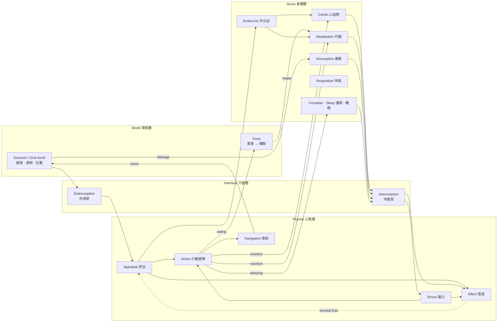

# Unbodysoma

> 一個「心智從身體長出來」的模擬人體引擎。
> *An embodied human simulation engine in which the mind emerges from — and feeds back into — the regulation of a simulated body.*


---

## 這是什麼？

多數「人體模擬」只做生理（心血管、代謝、藥物動力學），多數「AI 心智」則是沒有身體的符號或語言模型。
**Unbodysoma 想做的是兩者之間的那條迴路**：

- 身體有需要維持的狀態（血糖、體溫、心率、荷爾蒙……）；
- 心智的首要工作是**預測並調節**這些狀態（allostasis），而不是在身體之外下棋；
- 情緒是身體狀態被感知後的結果（interoception → affect），反過來又改變感知、決策與身體本身。

> 核心假設：**心智能力不是外掛在身體上的軟體，而是一個為了讓身體活下去而演化出的調節系統。**
> 詳見 [docs/VISION.md](docs/VISION.md)。

## 目前狀態：Phase 3 — 身心深化 I：微生物級（完成），下一步：無脊椎動物級

**Phase 2（2026-11-16 完成）**把四個子系統（心血管／內分泌／代謝／呼吸）升級到文獻模型（L1）並以自動化測試對照文獻反應曲線驗收；加上頻譜 HRV、族群執行器（個體差異抽樣與分布級驗收指標）與自足式 HTML 儀表板。

**Phase 3（2026-11-18 完成，[ADR-0013](docs/adr/0013-subsystem-focus-track.md)）**：微生物級的身心閉環——痛覺（雙相痛＋敏感化）、`neuro.*` 神經調節三軸（多巴胺＝恆定誤差移除的獎賞、血清素＝慢速情緒色調、正腎上腺素＝警覺）、中性刺激習慣化、能量池整合為淨葡萄糖平衡（腸促胰素相飽足、葡萄糖下潛的急性飢餓）、族群平行執行。

**下一步**：Phase 4 無脊椎動物級——Rescorla–Wagner 古典制約、操作制約、情節式記憶、場所趨避；`world.stimulus`（CS）、`world.damage`（US）與 `neuro.dopamine`（教學訊號）已就位。

底下的迴路與行為是 Phase 1 打下的基礎，目前依然成立——目前是一個刻意簡化（生理 L1／情感 L0）但有**多條完整閉環**的生物體，能在腳本化世界或 2D 網格世界中生活：

```text
威脅迴路：
環境威脅 → 外感受 → 評估(threat) → 腎上腺素 → 心率↑ → 內感受 → 喚醒度↑ ─┐
                         ↑                                            │
                         └──────── 高喚醒讓同樣的刺激看起來更危險 ◄───────┘
                     評估 → 行動選擇(逃跑) → 體力消耗 → 心率↑、能量↓

飢餓迴路：
能量儲備↓ → 內感受(能量不足) → 飢餓↑ → 看到食物 → 行動選擇(進食) → 攝取 → 儲備↑ → 飢餓↓
                                          （逃跑優先：威脅出現時會放下食物）

睡眠迴路：
清醒 → 睡眠壓力 S↑ ─┐   晝夜節律 C 調整入睡 / 起床門檻
                    ├→ 睡意 → 行動選擇(睡覺) → 心率↓、代謝↓、飢餓感↓ → S↓ → 自然醒
                    └─ 夠強的威脅或飢餓仍能叫醒；提早被叫醒的人會再睡回去

水與熱：
外面冷 → 核心體溫↓ → 顫抖（耗能）、冷的感覺 → 回庇護所 → 體溫回升
外面熱 / 跑動 → 核心體溫↑ → 流汗（耗水）→ 水分↓ → 口渴 → 找水 → 喝水 → 水分↑
```

所有行動（閒置、逃跑、進食、覓食、飲水、找水、回庇護所、睡眠）以效用競爭，並以機率方式選擇：同一情境下不同個體的行為有分布，同一個種子則逐位元可重現（[ADR-0007](docs/adr/0007-probabilistic-action-selection.md)）。心率有心率變異（HRV），心情有自發的波動。

恐懼反應範例（威脅在 60–90 秒出現）的部分輸出：

```text
       t  stimulus    threat   adrenal   HR(bpm)  exertion   arousal   valence   glucose
   50.00      0.00      0.01      0.01     64.70      0.00      0.02      0.08     90.02
   80.00      0.90      1.00      1.00    132.46      0.80      0.83     -0.81     90.72
  120.00      0.00      0.01      0.48    101.66      0.00      0.30      0.07     92.00
  300.00      0.00      0.01      0.01     67.70      0.00      0.09      0.07     92.65
```

進食範例（食物在 120 秒出現，400–430 秒進食中遇到威脅）的部分輸出——餐畢由胰島素飽足結束，能量在飯後一小時的腸道吸收中存入儲備：

```text
       t      food    threat    hunger    eating  exertion   reserve   valence
  180.00      1.00      0.00      0.63      1.00      0.00      0.40     -0.19
  410.00      1.00      0.90      0.46      0.00      0.80      0.40     -0.80
  450.00      1.00      0.00      0.45      1.00      0.00      0.40     -0.14
 1500.00      1.00      0.00      0.08      0.00      0.00      0.40      0.10
 3600.00      1.00      0.00      0.00      0.00      0.00      0.54      0.11
```

**網格世界的三天**（`scenarios/grid_72h.toml`：食物點長得很慢、兩個水源、一個當作家的庇護所、夜間約 8 °C、掠食者每天輪流造訪各食物點）：

```text
day 1 (08:00 to 08:00)
  sleeps    1  22:43-06:30 (7.8 h)
  meals     3  18:22 (10 min), 06:31 (10 min), 06:41 (7 min)
  drinks    2  18:52 (2 min), 07:21 (2 min)
  flights   0
day 3 (08:00 to 08:00)
  sleeps    1  22:13-05:42 (7.5 h)
  meals     4  11:59 (6 min), 16:36 (10 min), 05:43 (10 min), 06:01 (10 min)
  drinks    2  18:34 (2 min), 07:32 (2 min)
  flights   0

time at home: 97 %   in serious danger (threat > 0.6): 0.00 %
core temperature 36.40-37.00 C   lowest hydration 0.66
health alerts: none
```

每一晚都回到庇護所睡覺；三天都在掠食者的空檔時段短程外出覓食與飲水，唯一一次擦過活躍危險區的邊緣（day 1 傍晚）只帶來幾分鐘的輕微疼痛（`soma.nociception.pain`），沒有需要全力逃跑的近距離遭遇。這是 Phase 1 的完成情境，由 `tests/test_phase1.py` 驗收（[ROADMAP.md](docs/ROADMAP.md)）；「掠食者出現時逃跑」的反射本身以專屬的確定性測試把關（獵物在進食、掠食者抵達 → 逃跑並離開危險區），不依賴 72 小時軌跡與掠食者時窗的偶然相遇——軌跡是混亂的，加入痛覺的內感受通道後這顆種子的作息略有移動（更戀家），屬分布內的行為漂移。

> ⚠️ 現階段所有生理參數都是**示意用的玩具模型**，未經驗證，**不可用於任何醫療用途**。

## 快速開始

```bash
git clone https://github.com/Galen-Chu/Unbodysoma.git
cd Unbodysoma
python -m venv .venv && source .venv/bin/activate   # Windows: .venv\Scripts\activate
pip install -e ".[dev]"

python examples/fear_response.py          # 執行恐懼反應情境
python examples/fear_response.py --csv runs/fear.csv
python examples/lesion_study.py --runs runs/lesion_study   # 干預實驗 + 執行紀錄 + 健康監控
python examples/feeding.py                 # 飢餓迴路：進食、被威脅打斷、飽足
python examples/grid_life.py               # 網格世界的三天（約 3 分鐘）：睡眠、覓食、飲水、避寒、躲避掠食者
python -m unbodysoma run scenarios/fear_response.toml --out runs/fear   # 以 TOML 情境檔執行實驗
python -m unbodysoma replay runs/fear      # 重跑並逐位元驗證可重現
python -m unbodysoma dashboard runs/fear   # 產出自足式 HTML 儀表板（統計表、火花線、情感平面）
pip install -e ".[viz]" && python -m unbodysoma run scenarios/grid_72h.toml --rerun   # 選用：Rerun 即時觀看
python examples/population.py              # 12 個抽樣個體跑同一協議，輸出族群平均 ± 標準差
pytest                                     # 執行測試（含多日模擬；快速版：pytest -m "not slow"）
mypy                                       # 型別檢查（strict）
python -m unbodysoma.catalog               # 由規格重新產生 SIGNALS.md、PARAMETERS.md、SIGNAL_GRAPH.md
```

核心引擎**零外部相依**（僅 Python 標準函式庫）。

## 架構總覽



所有模組只透過一條**雙緩衝訊號匯流排（Signal Bus）**溝通，各自以不同頻率運行（神經毫秒級、心血管秒級、內分泌分鐘級、代謝小時級）。每個參數與訊號都有宣告式規格（單位、有效範圍、來源），引擎據此驗證，文件也由它自動產生。
詳見 [docs/ARCHITECTURE.md](docs/ARCHITECTURE.md)。

## 觀測與監控

模擬可以被**記錄、監控、倒帶與干預**，而且觀察不會改變結果：

```python
engine = build_minimal_human([Event(60, 90, "world.threat", 0.9)])
HealthMonitor(halt_on="critical").attach(engine)  # 生理 / 數值合理性警報
engine.lesion("interface.interoception")  # 干預：讓心智感覺不到身體
with RunWriter("runs/demo").attach(engine):  # meta.json · signals.csv · events.jsonl
    engine.run(300, until=lambda bus: bus.read("soma.cardio.heart_rate") > 180)
```

詳見 [docs/OBSERVABILITY.md](docs/OBSERVABILITY.md)。

## 專案結構

```text
src/unbodysoma/
├── core/        引擎核心：Engine、SignalBus、Module 契約、參數 / 訊號規格、快照、干預
├── soma/        身體層：cardio、endocrine、metabolism …
├── interface/   介面層：exteroception、interoception（未來：motor、proprioception）
├── psyche/      心智層：appraisal、affect、drives、action（未來：memory、attention、self-model）
├── world/       環境層：腳本化情境、食物、網格世界
├── observe/     觀測：執行紀錄、健康監控（未來：即時儀表板、重播）
├── config.py    TOML 情境檔（python -m unbodysoma run / validate）
├── catalog.py   由規格產生訊號表與參數表
└── presets.py   預組裝的生物體：minimal（腳本化世界）、grid（網格世界）
scenarios/       TOML 情境檔（包含 Phase 1 的 72 小時完成情境）
examples/        可執行範例
tests/           單元測試與行為回歸測試
docs/            設計文件與架構決策紀錄（ADR）
```

## 文件索引

| 文件 | 內容 |
|---|---|
| [VISION.md](docs/VISION.md) | 願景、核心假設、設計原則、範圍與非目標 |
| [ARCHITECTURE.md](docs/ARCHITECTURE.md) | 分層架構、訊號匯流排、排程、模型保真度分級 |
| [SOMA.md](docs/SOMA.md) | 身體層：子系統規劃與目前的模型方程式 |
| [PSYCHE.md](docs/PSYCHE.md) | 心智層：心智能力階梯、理論對應、設計取捨 |
| [SIGNALS.md](docs/SIGNALS.md) | 訊號命名規範與訊號表（自動產生） |
| [SIGNAL_GRAPH.md](docs/SIGNAL_GRAPH.md) | 模組之間的訊號依賴圖（自動產生） |
| [PARAMETERS.md](docs/PARAMETERS.md) | 所有模組參數：預設值、單位、有效範圍、來源（自動產生） |
| [SCENARIOS.md](docs/SCENARIOS.md) | TOML 情境檔格式與命令列 |
| [WORLDGEN.md](docs/WORLDGEN.md) | 程序化世界生成：abyssal-garden 管線分析（Phase 4 設計輸入，研究筆記） |
| [OBSERVABILITY.md](docs/OBSERVABILITY.md) | 觀測與監控：執行紀錄、健康監控、快照倒帶、干預實驗、儀表板規劃 |
| [VARIABILITY.md](docs/VARIABILITY.md) | 變異與統計真實性：避免「平均人」與眾數塌縮、已實作的變異、實作中的教訓 |
| [ROADMAP.md](docs/ROADMAP.md) | 分階段路線圖與待討論的開放問題 |
| [BACKLOG.md](docs/BACKLOG.md) | 跨階段開發優化盤點：模型深化、引擎效能、觀測、生態整合（2026-11-16 歸檔；2026-11-18 依 ADR-0013 重排） |
| [ETHICS.md](docs/ETHICS.md) | 醫療免責、意識宣稱、模擬負面狀態的倫理準則 |
| [REFERENCES.md](docs/REFERENCES.md) | 理論與既有模型參考文獻 |
| [adr/](docs/adr/) | 架構決策紀錄 |
| [CONTRIBUTING.md](CONTRIBUTING.md) | 開發流程與規範 |

## 路線圖摘要

| 階段 | 目標 |
|---|---|
| Phase 0 ✅ | 引擎骨架、最小閉環生物體、文件 |
| Phase 1 ✅ | 最小可行生物體：進食、飲水、體溫調節、睡眠與晝夜節律、機率式多行動競爭、HRV、網格世界（水源 / 庇護所 / 晝夜溫差）、TOML 情境檔、快照存檔與重播驗證、Rerun 即時檢視；72 小時完成情境 |
| Phase 2 ✅ | 生理保真度：文獻模型（L1）＋對照文獻曲線的自動驗收（心血管／內分泌／代謝／呼吸）、頻譜 HRV、族群執行器、專屬儀表板 |
| Phase 3 ✅ | 身心深化 I：微生物級——痛覺（雙相＋敏感化）、`neuro.*` 三軸、習慣化、恆定誤差獎賞、能量池整合、族群平行 |
| **Phase 4**（下一步） | 身心深化 II：無脊椎動物級——古典／操作制約、消弱與阻斷、情節式記憶、場所趨避 |
| Phase 4 | 身心深化 II：無脊椎動物級——古典／操作制約、消弱與阻斷、情節式記憶、場所趨避 |
| Phase 5 | 身心深化 III：脊椎動物級——注意力、預測性調節（allostasis）、主動推論對照 |
| Phase 6 | 人類級：自我模型、語言與社會互動 |
| 支撐軌道 | 世界與具身（原 Phase 4 的 3D 物理）、身體子系統深化、生態整合——依心智實驗需求拉入（ADR-0013） |

完整內容見 [docs/ROADMAP.md](docs/ROADMAP.md)。

## 授權

[MIT License](LICENSE) © 2026 Galen Chu

## 免責聲明

本專案為研究與教育用途的軟體實驗。它**不是**醫療器材、**不**提供醫療建議，也**不**宣稱模擬出的系統具有意識或感受。詳見 [docs/ETHICS.md](docs/ETHICS.md)。
