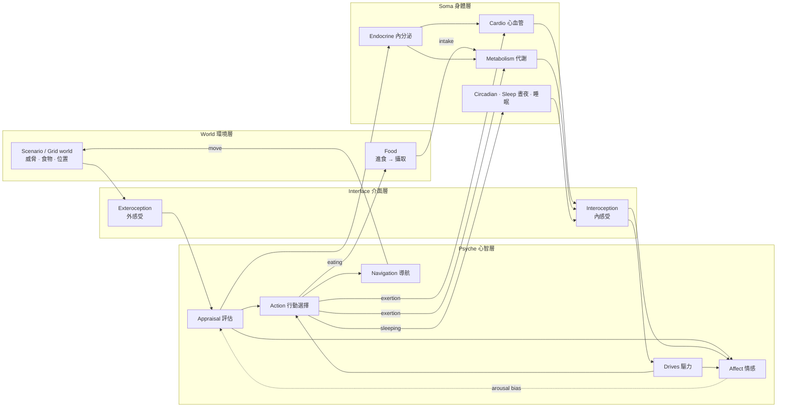

# Unbodysoma

> 一個「心智從身體長出來」的模擬人體引擎。
> *An embodied human simulation engine in which the mind emerges from — and feeds back into — the regulation of a simulated body.*


---

## 這是什麼？

多數「人體模擬」只做生理（心血管、代謝、藥物動力學），多數「AI 心智」則是沒有身體的符號或語言模型。
**Unbodysoma 想做的是兩者之間的那條迴路**：

- 身體有需要維持的狀態（血糖、體溫、心率、荷爾蒙……）；
- 心智的首要工作是**預測並調節**這些狀態（allostasis），而不是在身體之外下棋；
- 情緒是身體狀態被感知後的結果（interoception → affect），反過來又改變感知、決策與身體本身。

> 核心假設：**心智能力不是外掛在身體上的軟體，而是一個為了讓身體活下去而演化出的調節系統。**
> 詳見 [docs/VISION.md](docs/VISION.md)。

## 目前狀態：Phase 1 — 最小可行生物體（進行中）

目前是一個刻意簡化（L0 玩具等級）但有**三條完整閉環**的生物體，能在腳本化世界或 2D 網格世界中生活：

```text
威脅迴路：
環境威脅 → 外感受 → 評估(threat) → 腎上腺素 → 心率↑ → 內感受 → 喚醒度↑ ─┐
                         ↑                                            │
                         └──────── 高喚醒讓同樣的刺激看起來更危險 ◄───────┘
                     評估 → 行動選擇(逃跑) → 體力消耗 → 心率↑、能量↓

飢餓迴路：
能量儲備↓ → 內感受(能量不足) → 飢餓↑ → 看到食物 → 行動選擇(進食) → 攝取 → 儲備↑ → 飢餓↓
                                          （逃跑優先：威脅出現時會放下食物）

睡眠迴路：
清醒 → 睡眠壓力 S↑ ─┐   晝夜節律 C 調整入睡 / 起床門檻
                    ├→ 睡意 → 行動選擇(睡覺) → 心率↓、代謝↓、飢餓感↓ → S↓ → 自然醒
                    └─ 夠強的威脅或飢餓仍能叫醒；提早被叫醒的人會再睡回去
```

所有行動（閒置、逃跑、進食、探索、睡眠）以效用競爭，並以機率方式選擇：同一情境下不同個體的行為有分布，同一個種子則逐位元可重現（[ADR-0007](docs/adr/0007-probabilistic-action-selection.md)）。心率有心率變異（HRV），心情有自發的波動。

恐懼反應範例（威脅在 60–90 秒出現）的部分輸出：

```text
       t  stimulus    threat   adrenal   HR(bpm)  exertion   arousal   valence
   50.00      0.00      0.01      0.01     64.70      0.00      0.03      0.08
   80.00      0.90      1.00      1.00    157.75      0.80      0.99     -0.81
  120.00      0.00      0.01      0.48     87.88      0.00      0.21      0.07
  300.00      0.00      0.01      0.01     67.01      0.00      0.08      0.07
```

進食範例（食物在 120 秒出現，400–430 秒進食中遇到威脅）的部分輸出：

```text
       t      food    threat    hunger    eating  exertion   reserve   valence
  180.00      1.00      0.00      0.65      1.00      0.00      0.42     -0.25
  410.00      1.00      0.90      0.54      0.00      0.80      0.48     -0.99
  450.00      1.00      0.00      0.53      1.00      0.00      0.49     -0.21
 1500.00      1.00      0.00      0.07      0.00      0.00      0.76      0.06
```

**網格世界的三天**（`scenarios/grid_72h.toml`：食物點長得很慢、掠食者每天輪流造訪各食物點）：

```text
day 2 (08:00 to 08:00)
  sleeps    1  22:26-06:21 (7.9 h)
  meals     4  13:00 (6 min), 16:52 (4 min), 20:05 (3 min), 06:22 (10 min)
  flights   2  11:00, 11:49
day 3 (08:00 to 08:00)
  sleeps    1  22:24-05:42 (7.3 h)
  meals     5  08:36 (2 min), 12:08 (4 min), 14:01 (10 min), 05:43 (10 min), 07:32 (10 min)
  flights   9  10:26, 11:26, 11:26, 11:59, 11:59, 11:59, 11:59, 12:00, 17:00

time in serious danger (threat > 0.6): 0.00 %   health alerts: 0
```

第 3 天 11:26–12:00 的多次逃跑是**趨避衝突**：餓了想回到食物點，掠食者還在，於是一再接近又一再被嚇跑。

> ⚠️ 現階段所有生理參數都是**示意用的玩具模型**，未經驗證，**不可用於任何醫療用途**。

## 快速開始

```bash
git clone https://github.com/Galen-Chu/Unbodysoma.git
cd Unbodysoma
python -m venv .venv && source .venv/bin/activate   # Windows: .venv\Scripts\activate
pip install -e ".[dev]"

python examples/fear_response.py          # 執行恐懼反應情境
python examples/fear_response.py --csv runs/fear.csv
python examples/lesion_study.py --runs runs/lesion_study   # 干預實驗 + 執行紀錄 + 健康監控
python examples/feeding.py                 # 飢餓迴路：進食、被威脅打斷、飽足
python examples/grid_life.py               # 網格世界的三天（約 2 分鐘）：睡眠、覓食、躲避掠食者
python -m unbodysoma run scenarios/fear_response.toml --out runs/fear   # 以 TOML 情境檔執行實驗
pytest                                     # 執行測試（含多日模擬；快速版：pytest -m "not slow"）
mypy                                       # 型別檢查（strict）
python -m unbodysoma.catalog               # 由參數 / 訊號規格重新產生 docs/SIGNALS.md 與 docs/PARAMETERS.md
```

核心引擎**零外部相依**（僅 Python 標準函式庫）。

## 架構總覽



所有模組只透過一條**雙緩衝訊號匯流排（Signal Bus）**溝通，各自以不同頻率運行（神經毫秒級、心血管秒級、內分泌分鐘級、代謝小時級）。每個參數與訊號都有宣告式規格（單位、有效範圍、來源），引擎據此驗證，文件也由它自動產生。
詳見 [docs/ARCHITECTURE.md](docs/ARCHITECTURE.md)。

## 觀測與監控

模擬可以被**記錄、監控、倒帶與干預**，而且觀察不會改變結果：

```python
engine = build_minimal_human([Event(60, 90, "world.threat", 0.9)])
HealthMonitor(halt_on="critical").attach(engine)  # 生理 / 數值合理性警報
engine.lesion("interface.interoception")  # 干預：讓心智感覺不到身體
with RunWriter("runs/demo").attach(engine):  # meta.json · signals.csv · events.jsonl
    engine.run(300, until=lambda bus: bus.read("soma.cardio.heart_rate") > 180)
```

詳見 [docs/OBSERVABILITY.md](docs/OBSERVABILITY.md)。

## 專案結構

```text
src/unbodysoma/
├── core/        引擎核心：Engine、SignalBus、Module 契約、參數 / 訊號規格、快照、干預
├── soma/        身體層：cardio、endocrine、metabolism …
├── interface/   介面層：exteroception、interoception（未來：motor、proprioception）
├── psyche/      心智層：appraisal、affect、drives、action（未來：memory、attention、self-model）
├── world/       環境層：腳本化情境、食物、網格世界
├── observe/     觀測：執行紀錄、健康監控（未來：即時儀表板、重播）
├── config.py    TOML 情境檔（python -m unbodysoma run / validate）
├── catalog.py   由規格產生訊號表與參數表
└── presets.py   預組裝的生物體：minimal（腳本化世界）、grid（網格世界）
scenarios/       TOML 情境檔（包含 Phase 1 的 72 小時完成情境）
examples/        可執行範例
tests/           單元測試與行為回歸測試
docs/            設計文件與架構決策紀錄（ADR）
```

## 文件索引

| 文件 | 內容 |
|---|---|
| [VISION.md](docs/VISION.md) | 願景、核心假設、設計原則、範圍與非目標 |
| [ARCHITECTURE.md](docs/ARCHITECTURE.md) | 分層架構、訊號匯流排、排程、模型保真度分級 |
| [SOMA.md](docs/SOMA.md) | 身體層：子系統規劃與目前的模型方程式 |
| [PSYCHE.md](docs/PSYCHE.md) | 心智層：心智能力階梯、理論對應、設計取捨 |
| [SIGNALS.md](docs/SIGNALS.md) | 訊號命名規範與訊號表（自動產生） |
| [PARAMETERS.md](docs/PARAMETERS.md) | 所有模組參數：預設值、單位、有效範圍、來源（自動產生） |
| [SCENARIOS.md](docs/SCENARIOS.md) | TOML 情境檔格式與命令列 |
| [OBSERVABILITY.md](docs/OBSERVABILITY.md) | 觀測與監控：執行紀錄、健康監控、快照倒帶、干預實驗、儀表板規劃 |
| [VARIABILITY.md](docs/VARIABILITY.md) | 變異與統計真實性：避免「平均人」與眾數塌縮、已實作的變異、實作中的教訓 |
| [ROADMAP.md](docs/ROADMAP.md) | 分階段路線圖與待討論的開放問題 |
| [ETHICS.md](docs/ETHICS.md) | 醫療免責、意識宣稱、模擬負面狀態的倫理準則 |
| [REFERENCES.md](docs/REFERENCES.md) | 理論與既有模型參考文獻 |
| [adr/](docs/adr/) | 架構決策紀錄 |
| [CONTRIBUTING.md](CONTRIBUTING.md) | 開發流程與規範 |

## 路線圖摘要

| 階段 | 目標 |
|---|---|
| Phase 0 ✅ | 引擎骨架、最小閉環生物體、文件 |
| **Phase 1**（進行中） | 最小可行生物體：進食、睡眠與晝夜節律、機率式多行動競爭、HRV、網格世界、TOML 情境檔、72 小時完成情境（睡眠 / 覓食 / 避險）✅；口渴與飲水、體溫、庇護所、即時儀表板 ⬜ |
| Phase 2 | 生理保真度：文獻模型（L1）、對照文獻曲線驗證、外部生理引擎轉接 |
| Phase 3 | 會學習的心智：記憶、以內感受為獎賞的學習、預測處理 / 主動推論 |
| Phase 4 | 具身於 3D 世界：感覺運動迴路、物理模擬 |
| Phase 5 | 自我模型、語言與社會互動 |

完整內容見 [docs/ROADMAP.md](docs/ROADMAP.md)。

## 授權

[MIT License](LICENSE) © 2026 Galen Chu

## 免責聲明

本專案為研究與教育用途的軟體實驗。它**不是**醫療器材、**不**提供醫療建議，也**不**宣稱模擬出的系統具有意識或感受。詳見 [docs/ETHICS.md](docs/ETHICS.md)。
