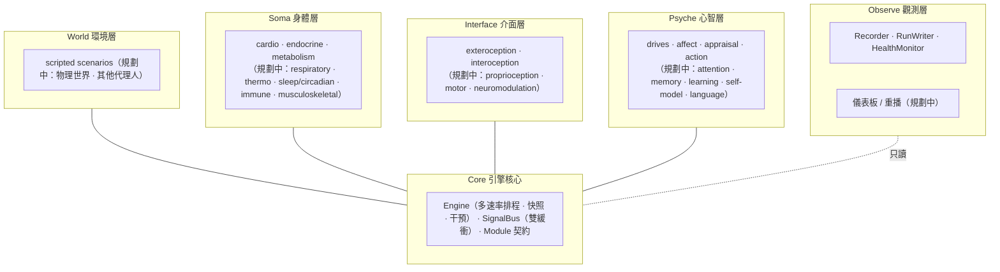
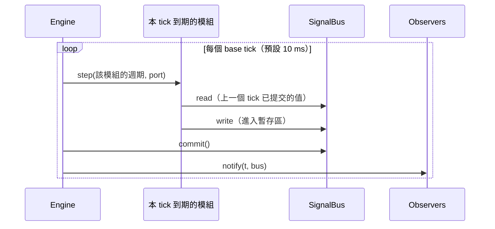

# 架構 Architecture

本文件描述 Unbodysoma 的整體架構。重大決策的理由記錄在 [adr/](adr/)。

## 1. 分層



| 層 | 套件 | 職責 | 關鍵規則 |
|---|---|---|---|
| Core | `core/` | 時間推進、訊號傳遞、契約檢查 | 不包含任何生理或心理知識 |
| World | `world/` | 產生環境刺激、接收身體對環境的作用 | 只寫 `world.*` |
| Soma | `soma/` | 生理狀態的動態 | 只讀身體、內分泌、運動指令；**不讀 `psyche.*`**，唯一例外是內分泌系統讀取評估結果（壓力反應的入口） |
| Interface | `interface/` | 世界 ↔ 身體 ↔ 心智的邊界：感覺與效應器 | 心智看到的是 `extero.*` / `intero.*`，**不能直接讀 `soma.*`** |
| Psyche | `psyche/` | 驅力、情感、評估、決策 | 對身體的影響只能經由 `motor.*` 或內分泌入口 |
| Observe | `observe/` | 記錄、健康監控、視覺化（見 [OBSERVABILITY.md](OBSERVABILITY.md)） | 只讀，不得寫入匯流排；唯一允許的副作用是要求停止 |

「心智不能直接讀身體」這條規則是刻意的：真實的大腦也只能透過有雜訊、有延遲的內感受訊號認識身體。內感受的**精確度與偏誤**因此成為可實驗的參數（例如模擬焦慮中對心跳的過度敏感）。

## 2. 模組契約

每個子系統都是一個 `Module`：

```python
class Module(ABC):
    name: str  # 唯一名稱，例："soma.cardio"
    rate_hz: float  # 執行頻率
    reads: tuple[str, ...]  # 宣告讀取的訊號
    writes: tuple[str, ...]  # 宣告寫入的訊號
    state_fields: tuple[str, ...]  # 宣告會改變的內部狀態（供快照使用）

    def setup(self, port): ...  # 發布初始值
    def step(self, dt, port): ...  # 推進 dt 秒並發布輸出
```

- 模組的內部狀態是私有的，**對外只透過訊號**；但必須在 `state_fields` 中宣告，讓引擎能存檔與還原（[ADR-0004](adr/0004-explicit-module-state.md)）。
- `port` 是模組對匯流排的受限視窗：寫入未宣告的訊號會丟出 `PermissionError`。
- 引擎在加入模組時檢查**每個訊號只有一個寫入者**，在啟動時檢查**每個被讀取的訊號都有人寫**。

這讓「替換一個模組」變成一件安全的事：只要新模組讀寫同一組訊號，其他模組不需要知道。

## 3. 訊號匯流排

訊號是帶命名空間的純量（`float`），命名規則見 [SIGNALS.md](SIGNALS.md)。

匯流排是**雙緩衝**的（[ADR-0002](adr/0002-double-buffered-signal-bus.md)）：

- 模組在一個 tick 中讀到的，一律是**上一個 tick 結束時**提交的值；
- 寫入先進入暫存區，所有模組跑完後才一次 `commit()`；
- 因此模組的執行順序**不影響結果**，並且每條訊號都自然帶有一個 tick 的傳導延遲——這和生物系統中的神經傳導延遲是同一回事。

## 4. 時間與排程

身體同時運作在差距極大的時間尺度上：

| 過程 | 典型時間尺度 | 目前頻率 |
|---|---|---|
| 感覺、評估、情感 | 10–100 ms | 10–20 Hz |
| 心跳、心率變化 | 1–10 s | 10 Hz |
| 腎上腺素 | 秒到分鐘 | 2 Hz |
| 皮質醇（HPA 軸） | 數十分鐘 | 2 Hz（時間常數 300–1800 s） |
| 能量儲備 | 小時 | 1 Hz |
| 晝夜節律（規劃中） | 24 h | — |

引擎採用**固定步長、多速率**排程（[ADR-0003](adr/0003-multi-rate-fixed-step-scheduling.md)）：



- base tick 預設 `dt = 0.01 s`；每個模組每 `round(1 / (rate_hz · dt))` 個 tick 執行一次。
- 模組在**自己週期的結尾**被執行，傳入的 `dt` 是整個週期長度，所以它發布的值對齊它所代表的時間點。
- 模組內部推薦用**解析解**（如 `relax()` 一階指數逼近）或穩定的積分法，避免慢模組大步長造成數值不穩定。

## 5. 模型保真度分級

每個模組都要標註保真度等級：

| 等級 | 定義 | 例子 |
|---|---|---|
| **L0 玩具** | 定性正確、參數示意，用來驗證架構與迴路 | 目前所有模組 |
| **L1 文獻** | 方程式與參數來自已發表模型，並引用來源 | Bergman 最小模型（血糖-胰島素）、Borbély 雙歷程睡眠模型 |
| **L2 驗證** | 能在容許誤差內重現文獻或資料集的反應曲線，並有自動化回歸測試；或轉接經驗證的外部引擎 | 透過轉接器包裝 Pulse / BioGears，或 FMI 共模擬 |

同一個訊號介面可以有多個不同等級的實作，情境設定可以挑選要用哪一個。

## 6. 決定性與可重現性

- 所有隨機性都來自模組自己持有、以種子初始化的 `random.Random`。
- 不使用牆鐘時間；不依賴 `set` 的迭代順序（字串雜湊每次執行都不同），需要時先排序。
- 測試 `test_same_seed_is_deterministic` 保證同種子逐位元相同。
- `Engine.snapshot()` / `restore()` 可以取出與還原完整狀態，倒帶後的結果與第一次逐位元相同。
- 掛上觀察者不會改變結果；干預只能透過引擎 API 進行並會被記錄（[ADR-0005](adr/0005-read-only-observation-logged-intervention.md)）。

## 7. 擴充點（規劃中）

| 擴充點 | 說明 |
|---|---|
| 情境設定檔 | 以 TOML / YAML 描述生物體組成、參數與事件時間軸，不必寫 Python |
| 外部生理引擎轉接器 | 把 Pulse、BioGears 或 FMI（Functional Mock-up Interface）模型包成 `Module` |
| 神經調節訊號 | `neuro.*`：多巴胺、血清素、正腎上腺素、乙醯膽鹼作為全域調節參數，影響學習率、注意力與探索 |
| 語言 / 敘事層 | 可選的語言模型轉接器，**只能讀取**心智狀態並產生自述，不能直接改寫身體或情感 |
| 物理世界 | 接入物理引擎（如 MuJoCo），讓運動真的有能量成本與感覺回饋 |
| 高效能核心 | 當 Python 成為瓶頸時，以 Rust 重寫 Core，Python 保留為模組撰寫與實驗介面（[ADR-0001](adr/0001-python-first-prototype.md)） |

## 8. 目前的程式碼對應

```text
src/unbodysoma/
├── core/bus.py          SignalBus、BusPort
├── core/module.py       Module 抽象類別
├── core/engine.py       Engine：多速率排程、契約檢查、觀察者、快照、干預
├── core/interventions.py Clamp、Lesion
├── core/dynamics.py     relax()、clamp()
├── soma/                Cardio、Endocrine、Metabolism
├── interface/           Exteroception、Interoception
├── psyche/              Appraisal、Affect、Drives、ActionSelection
├── world/scenario.py    Event、ScriptedWorld
├── observe/recorder.py  Recorder（記憶體內取樣）
├── observe/run.py       RunWriter、load_run（執行紀錄）
├── observe/health.py    HealthMonitor、規則
└── presets.py           build_minimal_human()
```
