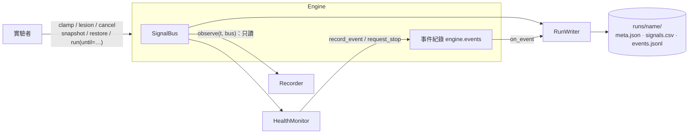

# 觀測與監控 Observability

一個身心耦合的系統會產生沒有人直接寫進程式的行為。觀測機制回答三個問題：**發生了什麼、為什麼發生、如果改變某個條件會怎樣。**

## 1. 兩條鐵律

1. **觀察不能改變模擬。** 掛上任何記錄器、監控器或儀表板，結果都必須逐位元相同（由 `test_observers_do_not_change_results` 把關）。觀察者只能讀匯流排。
2. **干預只能透過引擎 API 進行，而且必須被記錄。** `clamp`、`lesion`、`cancel` 都會寫進事件紀錄，因此「拿掉某個模組會怎樣」本身也是一個可重現的實驗（[ADR-0005](adr/0005-read-only-observation-logged-intervention.md)）。

唯一的例外是**停止**：健康監控器或中斷條件可以要求 `Engine.run` 提前返回。停止只會讓模擬提早結束，不會改變已經算出來的結果，而且停止本身也會被記錄成 `engine.stopped` 事件。



## 2. 五層觀測

| 層 | 功能 | 狀態 | 程式碼 |
|---|---|---|---|
| ① 執行紀錄 | 每次模擬一個自我描述的資料夾 | ✅ | `observe/run.py`：`RunWriter`、`load_run` |
| ② 健康監控 | 數值與生理合理性檢查、警報、必要時停止 | ✅ | `observe/health.py`：`HealthMonitor`、規則 |
| ③ 檢視與重播 | 存檔、倒帶、條件中斷 | 🟡 記憶體內快照與中斷已完成；快照存檔與重播介面尚未完成 | `Engine.snapshot` / `restore`、`run(until=…)` |
| ④ 即時儀表板 | 時間序列、身體狀態圖、情感平面、訊號依賴圖 | ⬜ 規劃中 | — |
| ⑤ 干預實驗 | 固定訊號、拿掉模組、分支實驗 | ✅ | `Engine.clamp` / `lesion` / `cancel` |

## 3. ① 執行紀錄

```python
from unbodysoma import build_minimal_human
from unbodysoma.observe import RunWriter, load_run
from unbodysoma.world import Event

engine = build_minimal_human([Event(60, 90, "world.threat", 0.9)], seed=0)
with RunWriter("runs/fear", every=0.1, config={"scenario": "fear", "seed": 0}).attach(engine):
    engine.run(300)

run = load_run("runs/fear")
run.column("soma.cardio.heart_rate")
run.events_of("health.alert")
```

| 檔案 | 內容 |
|---|---|
| `meta.json` | 建立時間、版本、Python 版本、git commit 與是否有未提交修改、`base_dt`、取樣間隔、使用者設定、所有模組的類別與讀寫宣告；結束時補上 `end_time` 與 `ticks` |
| `signals.csv` | 第一欄為時間，其後為**所有已宣告的訊號**；尚未發布的值留空（而不是 0） |
| `events.jsonl` | 每行一個事件：`intervention.*`、`health.*`、`engine.stopped`；包含掛上 RunWriter 之前就已發生的事件。無限大的時間寫成 `null` |

> 目前用 CSV 是為了保持零外部相依。當資料量變大時，可以改用 Parquet / Arrow，另立 ADR。

## 4. ② 健康監控

```python
from unbodysoma.observe import HealthMonitor, RangeRule, default_rules

monitor = HealthMonitor(default_rules(), every=0.1, halt_on="critical").attach(engine)
reason = engine.run(300)  # 遇到 critical 會提前返回，reason 以 "health:" 開頭
monitor.alerts  # 所有警報（含「已恢復」）
monitor.active  # 目前仍在警報中的項目
```

警報只在**狀態轉換**時發出（觸發 → `health.alert`、恢復 → `health.cleared`），不會每次取樣都重複。

**規則類型**

| 規則 | 意義 |
|---|---|
| `FiniteRule` | 任何訊號出現 NaN 或無限大 |
| `RangeRule(key, lo, hi)` | 訊號超出範圍 |
| `SustainedRule(key, duration, below= / above=)` | 訊號持續超過門檻達一段時間 |

自訂規則只需繼承 `Rule` 並實作 `violations(t, bus) -> {subject: message}`。

**預設規則**（粗略的合理性範圍，**不是臨床標準**）

| 名稱 | 條件 | 嚴重度 |
|---|---|---|
| `finite` | 任何訊號非有限數 | critical |
| `heart_rate_survivable` | 心率超出 [30, 220] bpm | critical |
| `heart_rate_abnormal` | 心率超出 [40, 180] bpm | warning |
| `glucose_abnormal` | 血糖超出 [50, 200] mg/dL | warning |
| `starvation` | 能量儲備 < 0.05 | warning |
| `prolonged_negative_valence` | valence < −0.5 持續 120 秒 | warning（落實 [ETHICS.md](ETHICS.md) §3 的「可見性」） |

## 5. ③ 快照、倒帶與中斷

```python
snap = engine.snapshot()  # 完整狀態：tick、所有訊號、所有模組狀態（含亂數產生器）
engine.run(60)
engine.restore(snap)  # 回到過去，之後的結果與第一次逐位元相同

engine.run(300, until=lambda bus: bus.read("soma.cardio.heart_rate") > 180)  # 條件中斷
```

快照之所以可行，是因為每個模組都必須宣告自己的可變狀態（[ADR-0004](adr/0004-explicit-module-state.md)）。測試 `test_every_mutable_attribute_is_covered_by_module_state` 會抓出漏宣告的欄位。

`restore` **不會**還原已排定的干預、觀察者與事件紀錄。這是刻意的設計，讓你可以從同一個時間點分出不同的實驗分支。

**尚未完成：** 快照寫入磁碟（需要處理亂數狀態的序列化）、從執行紀錄重播、時間軸拖曳介面。

## 6. ⑤ 干預實驗

```python
engine.clamp("soma.cardio.heart_rate", 65.0)  # 「β 阻斷劑」：心率固定在靜止值
engine.lesion("interface.interoception")  # 讓心智感覺不到身體
engine.lesion("psyche.appraisal", start=70, end=120, mode="freeze")
engine.cancel(intervention)
```

| 干預 | 語意 |
|---|---|
| `clamp(key, value, start, end)` | 所有**讀取者**看到固定值；寫入模組自己的內部狀態不受影響，類似刺激軸突而不是改寫神經元 |
| `lesion(module, mode="silence")` | 模組停止運作，所有輸出變成 0 |
| `lesion(module, mode="freeze")` | 模組停止運作，輸出與內部狀態凍結在最後的值 |
| `cancel(intervention)` | 移除一個已排定的干預 |

每個干預都會產生 `intervention.scheduled`、`intervention.started`、`intervention.ended` / `intervention.cancelled` 事件。

**分支實驗的寫法：** 先 `snapshot`，加上干預後執行；再 `restore`、`cancel`、重新執行，就能得到與完全沒有干預時逐位元相同的對照組（`test_branching_experiment_with_snapshot_and_cancel`）。

範例 `examples/lesion_study.py` 用四種條件比較同一次威脅：

```text
     condition         peak HR     peak threat    peak arousal     min valence          alerts           ended
        intact          160.58            1.00            1.00           -0.80               0       completed
     no_intero          160.58            1.00            0.40           -0.80               0       completed
  beta_blocker           65.00            1.00            0.43           -0.80               0       completed
      no_heart           65.51            0.02            0.04            0.09               2  halted at t=30.0s
```

拿掉內感受或固定心率之後，身體反應與威脅評估都還在，但**感受到的喚醒度**明顯降低。這正是「情緒有一部分來自感知自己的身體」這個假設的最小可運作示範（請記得這些都是 L0 玩具模型）。

## 7. ④ 即時儀表板（規劃）

**原則：先定好資料格式，再做畫面。** 儀表板只是執行紀錄與事件串流的另一種讀者，不需要改動引擎。

| 階段 | 做法 | 用途 |
|---|---|---|
| 近期 | 接入 [Rerun](https://rerun.io)：以觀察者把訊號與事件串流過去 | 即時時間序列、時間軸拖曳、幾乎不用寫前端 |
| 中期 | 從 `meta.json` 中的讀寫宣告自動產生訊號依賴圖，並即時標上數值 | 看出因果路徑 |
| Phase 2 | 專屬網頁儀表板：人體狀態圖、valence × arousal 情感平面軌跡、警報時間軸 | 展示與教學 |

可選相依（如 Rerun）會放在 `pip install unbodysoma[viz]` 之類的額外選項，核心維持零外部相依。
