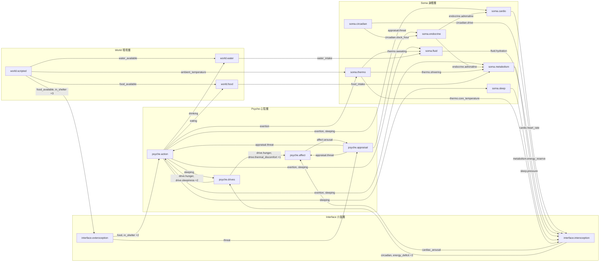
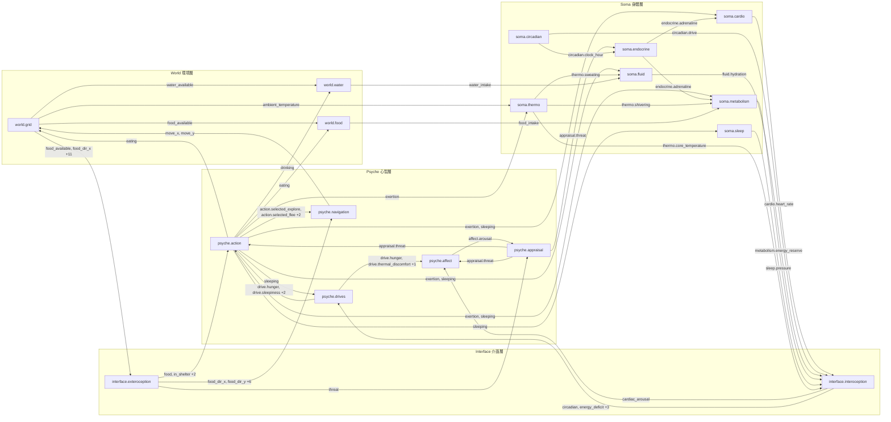

# 訊號依賴圖 Signal graph

> 本文件由 `python -m unbodysoma.catalog` 從模組的 `reads` / `writes` 宣告自動產生，**請勿手動編輯**。
> 每條邊代表「寫入者 → 讀取者」，標籤是經過的訊號（省略最外層的命名空間，例如 `soma.cardio.heart_rate` 寫成 `cardio.heart_rate`）；訊號的意義見 [SIGNALS.md](SIGNALS.md)。

## minimal：腳本化世界

## grid：網格世界

